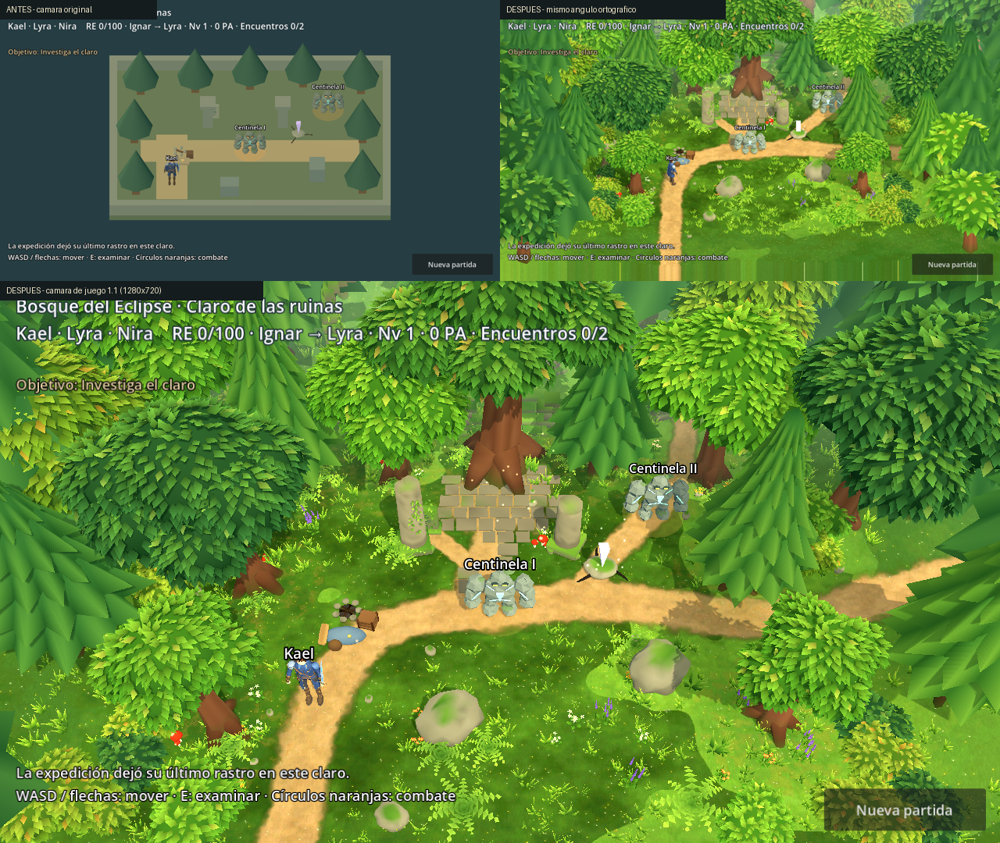
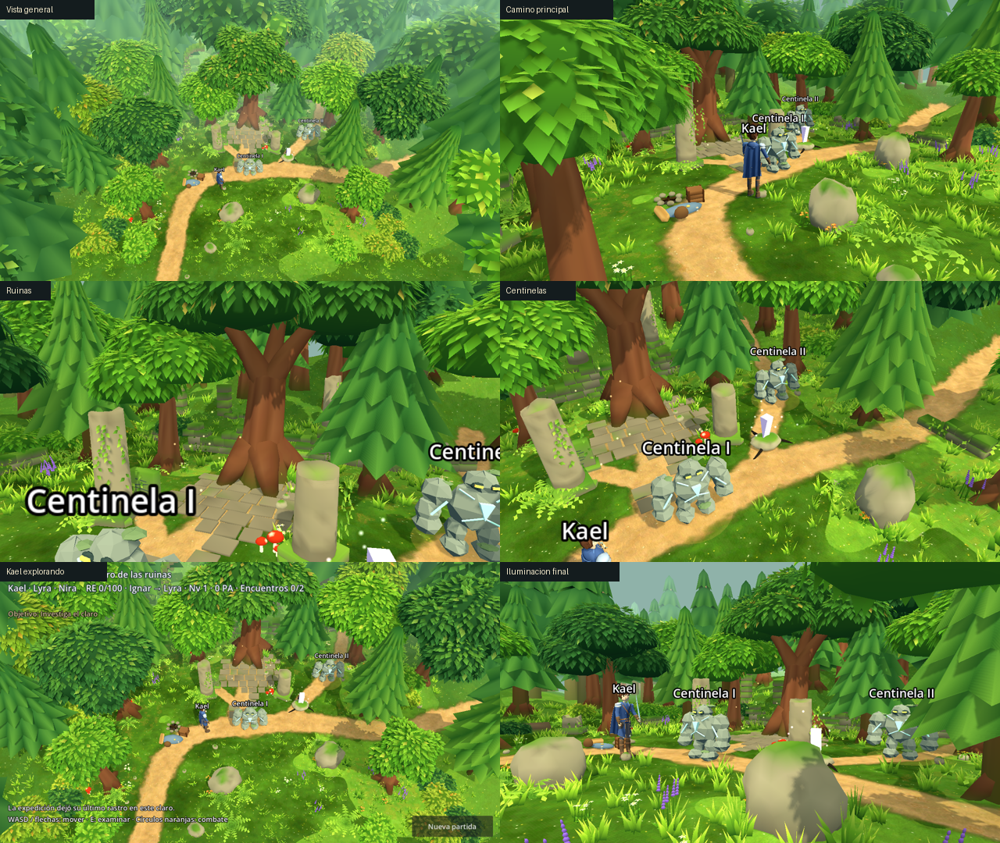

# Bosque del Eclipse — renovación artística del claro (1.1)

Fecha: **9 de noviembre de 2026**. Estado: **activa por defecto** (`visuals/forest/renovated=true`). El escenario anterior se conserva intacto como respaldo (`false`). Sin cambios de combate, estadísticas, Guardianes, Resonancia, encuentros, narrativa, diálogos ni estado de partida.



Arriba a la izquierda: escenario anterior. Arriba a la derecha: escenario renovado **desde el mismo ángulo ortográfico**. Abajo: escenario renovado con la cámara de juego 1.1. Todas son capturas reales de Godot 4.7.2 (Compatibility), no renders de Blender.



Cómo verlo: **F5** (el arranque es el claro). Para el respaldo, poner `visuals/forest/renovated=false` en `project.godot`. Capturas: `godot --path . --script res://tools/capture_forest.gd` (exige render real; escribe en `docs/previews/forest/`).

## Qué cambia

**Composición.** El claro deja de ser un rectángulo con objetos repartidos:

- **Punto focal:** un árbol anciano sobre una plaza de losas, detrás del «Eco bajo las ruinas». Sus raíces se apoyan en la mampostería, de acuerdo con el texto que ya existía («Un camino bajo las raíces»). No se añaden nombres, símbolos, inscripciones ni lore.
- **Líneas guía:** el sendero de tierra sigue el recorrido real de la misión: entra por el sur junto al punto de inicio, pasa por el campamento y el Centinela I, se bifurca hacia la plaza (entre las dos columnas) y hacia el Centinela II. Además, sale por el este y sube por el talud, lo que sugiere que el bosque continúa.
- **Planos:** el primer plano está formado por arbustos bajos, hierba y flores que enmarcan los bordes. El plano medio lo forman el claro, las ruinas, las rocas y los árboles principales. Al fondo hay taludes que se elevan, muros rotos, un arco, columnas caídas y un bosque denso de pinos y frondosas que se pierde en la neblina.
- **Zonas abiertas y frondosas:** el centro queda despejado y legible. La vegetación se agrupa deliberadamente en torno a troncos, rocas, columnas y bordes, no como ruido uniforme.
- **Ruinas:** dos columnas erosionadas con hiedra (sobre los colliders originales), losas desgastadas, escalones sobre el talud norte, muros de piedra en hiladas irregulares, un arco roto, tocones de columna y un tronco caído.

**Puntos narrativos.** Solo cambia su presentación, con los mismos elementos que ya tenían las primitivas: manta, petate, caja, insignia, taza y hoguera apagada en el campamento; la misma estela con cinco líneas grabadas en la inscripción; roca con tres raíces ennegrecidas bajo el cristal. La gema animada, la anomalía, los anillos, las etiquetas, los radios y la lógica no se tocan. Los props se anclan en tiempo de ejecución a `ExpeditionStory.POINTS`.

**Iluminación y atmósfera.** Sol cálido (`ffe0b0`, energía 0,95) con sombra direccional de una cascada. Ambiente frío tenue (`9fb9c4`) y tonemap fílmico sin bloom. Neblina de profundidad (`fog_mode = depth`, 25–50 m) que solo afecta al fondo. Detalle mágico discreto: 26 motas aditivas (CPUParticles3D) en la plaza de ruinas y junto al cristal. No hay luces dinámicas adicionales ni efectos volumétricos.

**Cámara.** Sigue siendo fija y sin giro libre. Pasa de ortográfica (tamaño 18, en `(0,17,18)`) a perspectiva de 40° en `(0,18.5,14.5)`, que mira a `(0,0,-0.8)`. El eje X de pantalla sigue siendo el X del mundo, así que WASD, flechas y la entrada táctil prevista funcionan igual. Toda la zona transitable cabe en pantalla en 3:2, 16:9, 4:3 y 20:9 (comprobado por proyección en las pruebas).

**Legibilidad.** Desde la cámara fija, las copas grandes de los bordes podían tapar a Kael en zonas transitables, como se vio en capturas reales a 960×640. El follaje de los árboles principales se recorta con un tramado (dither 4×4, acorde con el estilo retro) en el cono cámara→Kael. Solo usa ese material el follaje de los 7 kits principales; el resto mantiene un shader opaco sin `discard`.

## Herramientas y procedencia

| Recurso | Procedencia | Licencia |
|---|---|---|
| Geometría, colores de vértice y composición: `assets/environments/eclipse_forest/eclipse_clearing.blend/.glb` | Original, generada por `tools/blender/build_eclipse_clearing.py` (Blender 5.2.1) | Propia del proyecto |
| Suelo pintado `ground_paint.png` (2048²) y trazos `ground_detail.png` (512², repetible) | Original, pintado algorítmico en el mismo script (numpy) | Propia del proyecto |
| Shaders `world/shaders/forest_{foliage,ground,surface}.gdshader` | Originales | Propia del proyecto |

**No se usan assets externos.** La investigación 1.0 (`ASSET_LICENSES.md`) dejó sin candidato legalmente despejado y adecuado: JustCreate requiere compra, Quaternius tiene condiciones CC0/QAL contradictorias y Kenney no aporta el acabado buscado. No se ha descargado, comprado ni iniciado sesión en ningún servicio.

El kit no es una pila de primitivas: los troncos tienen sección asimétrica, acanaladuras, ensanchamiento, raíces enterradas y ramas visibles hacia cada masa de hojas. Las copas combinan un núcleo oscuro con cientos de hojas opacas plegadas (2 triángulos) cuyo color varía con la orientación. Los pinos tienen pisos dentados con caída. Las rocas son esferas deformadas con musgo según la orientación, y la mampostería, bloques biselados con desconchones. No hay transparencias alfa en la vegetación.

### Flujo

```powershell
$blender = 'C:\Program Files\Blender Foundation\Blender 5.2\blender.exe'
$godot = 'C:\Users\aleja\Downloads\Godot_v4.7.2-stable_win64.exe\Godot_v4.7.2-stable_win64_console.exe'
& $blender --background --factory-startup --python-exit-code 1 --python tools/blender/build_eclipse_clearing.py              # regenera fuente, texturas y GLB
& $blender --background --factory-startup --python-exit-code 1 --python tools/blender/build_eclipse_clearing.py -- --export-only  # reabre el .blend guardado y solo reexporta
& $godot --headless --path . --editor --import
& $godot --headless --path . --script res://tests/test_battle.gd
& $godot --path . --script res://tools/capture_forest.gd
```

Regenerar **sobrescribe** la fuente. Para conservar ediciones manuales en el `.blend`, usar `--export-only`; se verificó que produce el mismo GLB (1233 nodos, 252.517 triángulos) sin modificar el `.blend`. El suelo pintado solo se regenera en el modo completo.

### Estructura

- `assets/environments/eclipse_forest/`: `eclipse_clearing.blend` (fuente), `.glb` (kit + composición: 1233 nodos que referencian 37 mallas compartidas), `ground_paint.png`, `ground_detail.png` y `eclipse_clearing_manifest.json` (triángulos por malla, instancias, materiales y hashes).
- `world/forest_art.gd` (`ForestArt`): carga el GLB y fusiona cada malla repetida en un `MultiMeshInstance3D` (26 conjuntos más 11 mallas únicas). Sustituye los materiales importados por los shaders móviles según su nombre (`Bark`, `Foliage`, `Plant`, `Bloom`, `Stone`, `Ground`) y configura luz, neblina, cámara, motas y transparencia de copas. **No crea cuerpos físicos.**
- `world/forest_zone.gd`: rama renovada con **los mismos 18 colliders** (posiciones, tamaños, capas y máscaras idénticos), sin sus mallas provisionales. La rama anterior queda intacta.
- `narrative/narrative_interest.gd`: en modo renovado omite sus cajas provisionales de campamento, inscripción y base del cristal; conserva la energía animada.
- Importación: GLB sin tangentes, sin LOD automáticos ni animación. Texturas del suelo con compresión VRAM y mipmaps.

### Detalle técnico: color de vértice

El glTF almacena el color de vértice en espacio lineal, pero el renderizador Compatibility de Godot 4.7.2 lo trata como sRGB y lo vuelve a linealizar. Se midió: un `COLOR` de 0,2 en un shader sin iluminación da 0,196 en pantalla. Resultado: troncos rojo saturado y verdes oscurecidos. Los shaders del bosque deshacen esa segunda conversión (`vertex_linear`). Si en el futuro se cambia de renderizador, hay que revisarlo.

## Presupuestos y medidas

Medidos con `tools/capture_forest.gd` a 1280×720 en escritorio (Intel Arc integrada, Compatibility, vsync). Ver `previews/forest/metrics.json`.

| | Anterior | Renovado |
|---|---:|---:|
| Draw calls por frame | 91 | 148 |
| Primitivas por frame (incluye pase de sombra) | 13.982 | 380.350 |
| Objetos por frame | 502 | 559 |
| Memoria de texturas | 13,7 MB | 16,6 MB |
| Memoria de vídeo total | 39,6 MB | 44,8 MB |
| FPS escritorio (limitado por vsync) | 60 | 60 |

- Escena: 252.517 triángulos en 1233 instancias, 57 superficies y 6 materiales. Lo que más pesa: pinos lejanos (~37k), copas principales (~60k, que también se dibujan en el pase de sombra), hierba (~26k en 972 matas de 27 triángulos) y bosque lejano frondoso (~40k).
- Texturas: 2048² + 512², comprimidas en VRAM con mipmaps (~+2,9 MB). El resto del color va en los vértices.
- Sombras: una cascada ortogonal de 38 m. No proyectan sombra la hierba, las flores, los helechos, los arbustos, las piedras pequeñas, el suelo ni el bosque lejano.
- Recortes aplicados tras medir: de 2 cascadas a 1, arbustos sin sombra, malla del terreno a 0,8 m y menos hojas. Los árboles lejanos que nunca entran en el frustum de la cámara fija (20:9 con margen) no se colocan. Con todo ello se pasó de 451k a 380k primitivas por frame.
- Los MultiMesh se descartan por su caja completa, sin culling por instancia. Con cámara fija apenas importa; en zonas mayores habría que trocear los conjuntos por regiones.

**Rendimiento móvil: NO medido.** No se ha exportado a Android ni probado en un dispositivo. El objetivo de 30 FPS estables en gama media **no se declara conseguido**. 380k primitivas con unos 150 draw calls es un orden de magnitud habitual en GLES3, pero el coste real dependerá del relleno: copas superpuestas, wrap lighting y el viento en el vertex shader. Para exportar a móvil habrá que activar `rendering/textures/vram_compression/import_etc2_astc`.

## Pruebas

- Antes de esta iteración: **777 comprobaciones, 0 fallos** (más el borrador sin integrar de la sesión anterior).
- Después: **820 comprobaciones, 0 fallos** (`tests/test_battle.gd`, headless). Las 777 anteriores se mantienen sin cambios y ahora se ejecutan **con el bosque renovado activo por defecto**: exploración, colisiones, encuentros, transición y retorno, narrativa, derrota y nueva partida.
- `tests/forest_art_checks.gd` (43) cubre problemas reales:
  - El fallback conserva los 18 colliders y la cámara original.
  - La versión renovada mantiene transformaciones, tamaños y máscaras físicas idénticas.
  - Se conservan las anclas y los radios de centinelas y pistas.
  - Kael recorre físicamente el camino completo sin bloqueos e investiga las tres pistas.
  - El encuadre cubre la zona transitable en 4 relaciones de aspecto.
  - El arte no añade cuerpos físicos.
  - Los props narrativos están anclados a `ExpeditionStory` y las primitivas no se duplican.
  - La transparencia de copas sigue a Kael desde la cámara real.
  - Hay una guarda del presupuesto.
- Render real revisado a 1280×720, 960×640 y 800×450, más las 6 vistas temáticas y 9 posiciones de borde para comprobar la oclusión.

## Límites conocidos

- Es arte original generado mediante script y ajustado por iteración visual en Godot. **No es pintura a mano ni modelado manual de artista.** Las hojas son geométricas y, de cerca (vista «Ruinas»), los troncos y las columnas resultan lisos y algo plásticos. Desde la cámara de juego funcionan; en primeros planos se nota la falta de textura pintada.
- Las raíces del árbol anciano siguen siendo radiales vistas desde arriba. La mampostería de fondo queda en gran parte tapada por las copas desde la cámara de juego.
- Los Centinelas, Kael, el cristal y la anomalía conservan sus modelos y materiales. La gema del cristal se ve casi blanca con la nueva luz.
- El texto del HUD (sobre todo «Objetivo», amarillo y pequeño) pierde algo de contraste sobre el follaje claro. La interfaz es provisional y no se ha tocado.
- El suelo es plano en toda la zona jugable (la física no cambia). El relieve está en los taludes exteriores.
- Rendimiento y memoria en móvil sin medir; ver arriba.

## Recomendaciones para otros escenarios

1. Diseñar desde la cámara real: componer foco, líneas guía y planos antes de rellenar, y validar con capturas en Godot en cada iteración.
2. Reutilizar el kit y los shaders: la composición en Blender se convierte en MultiMesh en Godot. Una zona nueva necesita su composición y su suelo pintado, no un kit nuevo.
3. Mantener los colliders como contrato aparte, en GDScript y probados, y vestirlos con arte.
4. Al ampliar zonas, trocear los MultiMesh por regiones para recuperar el culling, y probar en un dispositivo Android real antes de subir densidades.
5. Si se pueden adquirir assets (con licencia verificada), el mayor salto vendría de texturas pintadas para cortezas y piedra y de follaje con tarjetas alfa bien optimizadas. Hasta entonces, mantener la vegetación opaca.
