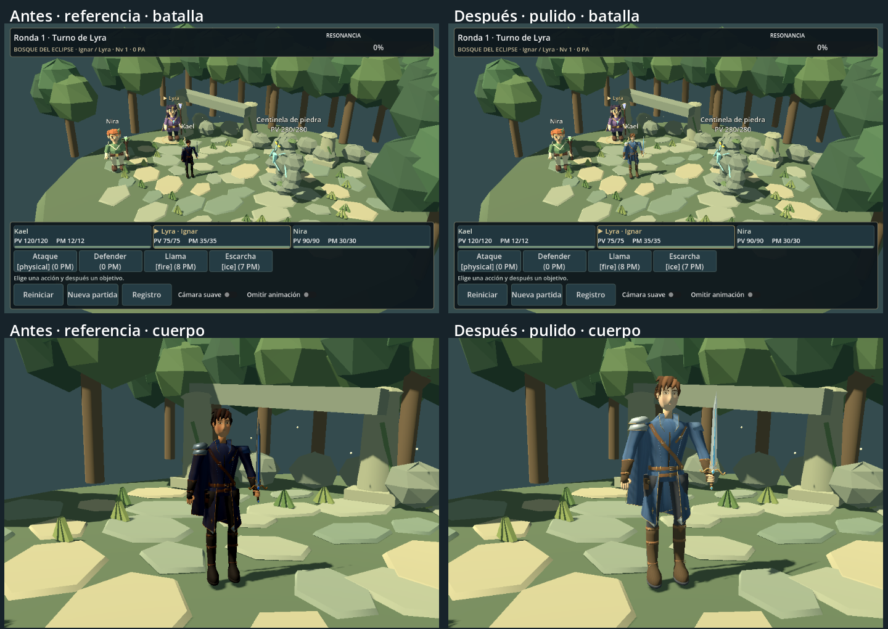

# Kael: pulido del modelo de referencia

Se ha editado la fuente guardada de `reference_study`, conservando su topología, UV y diseño. El resultado está en `assets/characters/kael/polished/` y es el modelo seleccionado al arrancar el juego. La versión anterior permanece intacta. No se han modificado reglas, estadísticas, historia, escenario ni los otros personajes.

La mejora verificable es de **escala, legibilidad de materiales e integración de las animaciones**. No equivale a un personaje comercial terminado: el rostro y el cabello todavía tienen un acabado sencillo, y la animación necesita una revisión artística más fina.

## Evidencia visual en Godot



- [Captura inicial antes de intervenir](previews/kael-polish/initial-battle.png).
- Batalla comparable: [antes](previews/kael-polish/before-battle-960x640.png) / [después](previews/kael-polish/after-battle-960x640.png).
- Resoluciones adicionales: [1280×720](previews/kael-polish/after-battle-1280x720.png), [800×450](previews/kael-polish/after-battle-800x450.png).
- [Rostro y torso](previews/kael-polish/after-face-torso.png), [cuerpo completo](previews/kael-polish/after-full.png).
- [Exploración, cámara normal](previews/kael-polish/after-exploration.png), [caminar, cámara de detalle](previews/kael-polish/after-exploration-walk.png).
- Ataque: [preparación](previews/kael-polish/after-attack-30.png), [corte](previews/kael-polish/after-attack-55.png), [recuperación](previews/kael-polish/after-attack-72.png).
- [Defensa](previews/kael-polish/after-defend.png), [daño](previews/kael-polish/after-hurt.png), [KO](previews/kael-polish/after-ko.png).
- [Vídeo de las seis animaciones](previews/kael-polish/motion.mp4): captura de Godot, 960×640, 30 FPS. Usa la iluminación del visor de revisión, diferente de la batalla; Walk se reproduce en el sitio. No acredita rendimiento móvil.

Las parejas de imágenes emplean las mismas cámaras, resoluciones e iluminación y transformaciones de escala unitaria. **El cambio de tamaño está horneado en la malla y el rig**: no se ha ampliado la imagen ni acercado su cámara para aparentar mejora. Las vistas de detalle son adicionales a las de juego. La captura de caminar usa desplazamiento físico real; la fase exacta del paso depende del tiempo de render. La comparación de exploración aplica a ambas versiones la corrección visual de apoyo de la cápsula. La captura inicial se conserva por separado.

## Inspección inicial y cambios

La base ejecutada era `reference_study/kael.glb`, con fuente `kael.blend`, atlas `kael_atlas.png`, rig de 17 huesos y seis Actions. Antes de editar se ejecutaron **596 comprobaciones, cero fallos**, se abrió la fuente en Blender y se capturó la batalla real.

Se ejecutó Blender **5.2.1 LTS** por CLI para editar, guardar, reabrir y reexportar la fuente. Los manifiestos registran hashes de las fuentes anterior y nueva, GLB, atlas y script. La prueba de trazabilidad verifica que la fuente anterior continúa intacta.

### Escala

Se horneó un factor de altura 1,18 en vértices y huesos, con un ensanchamiento adicional del torso del 8 % y profundidad del 4 %, atenuado hacia el cuello. La cabeza conserva la proporción del diseño anterior; no se han añadido músculos ni aumentado solo la cabeza. Manos, piernas y espada acompañan el escalado general.

Medida de la AABB de la silueta de las mallas de cada actor, con el mismo inspector Godot. Incluye accesorios y **no es una medición anatómica ni de la deformación de cada fotograma**:

| Actor | Altura antes | Altura después |
|---|---:|---:|
| Kael | 1,8695 | 2,2060 |
| Lyra | 2,2885 | 2,2885 |
| Nira | 2,2025 | 2,2025 |
| Centinela | 2,5347 | 2,5347 |

El mismo GLB se utiliza a escala unitaria en combate y exploración. `exploration_player._ready()` coloca la presentación en el apoyo real de su cápsula, a Y local 0,05. No cambia la cápsula, la velocidad ni las colisiones.

### Materiales

Se detectaron dos causas de oscuridad: valores de paleta lineales guardados como textura sRGB, y una imagen empaquetada antigua que podía persistir en la exportación aunque el PNG separado estuviera actualizado. `polish_atlas()` corrige la codificación, conserva la variación del atlas y carga el PNG revisado en un datablock nuevo antes de empaquetarlo. **Una prueba compara los bytes del PNG incrustado en el GLB con el PNG fuente** para detectar esta regresión.

Se ajustó la paleta azul, cuero y castaño; metal con metallic 0,40 y roughness 0,48, tela/piel con roughness 0,86. El cristal mantiene emisión discreta. Se conservan tres materiales y cinco superficies, todos iluminados. No se han añadido luces ni alterado la iluminación global: el contraste se resuelve en el recurso, con la misma luz que el resto del escenario.

### Animaciones

| Clip | Duración | Trabajo realizado |
|---|---:|---|
| Idle | 3 s | Respiración pequeña en torso y brazos; pies plantados |
| Walk | 0,6 s | Trayectoria de apoyo y oscilación horneadas mediante IK de dos segmentos; mezcla de locomoción de 0,12 s |
| Attack | 0,8 s | Preparación alta, corte descendente exterior y recuperación; recorrido explícito de muñeca/espada |
| Hurt | 0,4 s | Retroceso del torso y recuperación |
| Defend | 0,4 s | Codos flexionados, brazo de apoyo delante y espada elevada |
| KO | 1 s | Flexión parcial y caída, con corrección de apoyo horneada |

La IK solo se utiliza al preparar el archivo en Blender. El juego reproduce claves del rig existente; no ejecuta IK ni recorre vértices cada frame. Las claves se hornean a 60 Hz para limitar penetraciones entre muestras. Una prueba inicial a 30 Hz detectó un mínimo de −7,8 mm en Walk; se corrigió la densidad de claves y el margen de apoyo. Las pruebas finales evalúan la malla deformada importada a 120 muestras/s en Walk y KO, incluyendo puntos entre claves. Mínimos finales: Walk +0,000962 m; KO +0,005926 m.

La zancada de 1 m por medio ciclo corresponde a 3,333 m/s; al desplazarse a 4 m/s la reproducción usa 1,2×. `set_walking()` toma la velocidad horizontal real. No se cambia la velocidad del jugador. Se elimina el desplazamiento artificial de 0,65 m del cuerpo al atacar, que hacía resbalar los pies.

`BattleActorVisual.presentation_duration()` y `battle_stage._play_event()` respetan las duraciones del manifiesto en la presentación. Ya no se comprimen Attack y KO a 0,36 s. El motor resuelve exactamente las mismas acciones. Reiniciar y omitir conservan sus mecanismos de cancelación.

## Presupuesto

| Medida | Referencia anterior | Pulido |
|---|---:|---:|
| Triángulos | 12 297 | 12 297 |
| Vértices de autor | 8 184 | 8 184 |
| Vértices exportados | 14 830 | 14 830 |
| Superficies / materiales | 5 / 3 | 5 / 3 |
| Huesos | 17 | 17 |
| Atlas | 1024×1024 | 1024×1024 |
| GLB | 1 698 344 bytes | 1 759 468 bytes |

El manifiesto es la fuente exacta del tamaño y hashes de la exportación. El PNG ocupa 812 453 bytes; la fuente Blender, aproximadamente 1,25 MiB. El payload de atributos/índices glTF suma 844 942 bytes (~0,81 MiB), sin estructuras del motor. Una textura RGBA8 1024² supone 4 MiB sin mipmaps o ~5,33 MiB con cadena completa. Geometría más atlas rondan 6,2 MiB como estimación base; no incluye duplicados CPU/GPU, overhead, bibliotecas de animación por instancia ni render targets. No es una medición de VRAM de Android.

Cinco superficies suponen hasta cinco envíos de geometría en el pase principal por instancia; sombras y otros pases añaden trabajo. Se mantienen los materiales de doble cara de la fuente, susceptibles de optimización tras una revisión de normales y prendas. No se han añadido luces por personaje, físicas de capa ni shaders complejos. No se han probado dispositivos Android/iOS: **30 FPS en gama media sigue siendo un objetivo pendiente**.

## Archivos y reproducción

- `tools/blender/polish_kael.py`: `polish_mesh`, `polish_atlas`, `pose_frame`, `arm_ik`, `leg_ik`, `animate`, `export`. Modifica la fuente guardada; no llama a los generadores de geometría.
- `assets/characters/kael/polished/`: `.blend`, GLB autosuficiente, atlas, manifiesto e importación Godot. El `.blend` usa importer `keep`; ejecutar el juego no requiere Blender.
- `scenes/kael_model.gd`: velocidad, mezcla y duración configuradas por asset.
- `scenes/battle_actor_visual.gd`, `scenes/battle_stage.gd`: selección de recurso y tiempos de presentación.
- `world/exploration_player.gd`: apoyo visual y sincronización de Walk.
- `scenes/kael_polish_preview.tscn`: visor con seis clips y comparación con la fuente anterior; reutiliza el visor existente mediante propiedades exportadas.
- `tools/capture_kael_polish.gd`, `tools/capture_kael_motion.gd`: capturas reales y grabación del GLB importado.
- `tests/kael_polish_checks.gd`: 28 comprobaciones adicionales, integradas en `tests/test_battle.gd`.
- `project.godot`: `visuals/kael/asset_version="polished"`, compartido por ambos modos.

Para jugar, detener la ejecución anterior con **F8** y arrancar con **F5**. Para combate directo, abrir `scenes/battle_3d.tscn` y pulsar **F6**. Para revisar el modelo y los clips, abrir `scenes/kael_polish_preview.tscn` y pulsar **F6**. El selector `reference-study` recupera el modelo previo en ambos modos.

Comandos desde la raíz, con `$godot` y `$blender` apuntando a los ejecutables locales:

```powershell
# Preserva ediciones manuales de polished/kael.blend:
& $blender --background --factory-startup --python-exit-code 1 --python tools/blender/polish_kael.py -- --export-only
& $godot --headless --editor --path . --import
& $godot --headless --path . --script res://tests/test_battle.gd
& $godot --path . --script res://tests/test_battle.gd
& $godot --path . --script res://tools/capture_kael_polish.gd
& $godot --path . --script res://tools/capture_kael_motion.gd --write-movie "$env:TEMP/kael-polish.avi" --fixed-fps 30 -- --polished
```

Sin `--export-only`, el script vuelve a abrir **la referencia anterior** y reaplica este pulido sobre la carpeta `polished`; sobrescribe sus ediciones manuales. No usar ese modo para reexportar retoques guardados. Las versiones anteriores no se escriben.

## Validación y criterio artístico

**624 comprobaciones, cero fallos**, tanto headless como con render real Godot 4.7.2 Compatibility en Intel Arc. Se conservan las 596 anteriores. Las nuevas cubren trazabilidad, atlas realmente incrustado, presupuesto importado, clips independientes, bucles, velocidad, skin sobre el plano, corredor de seguridad de la espada durante Attack, tiempos completos, reinicio y mismo recurso en exploración. La prueba del corredor del torso no sustituye una detección exhaustiva de autocolisiones de toda la ropa.

Registros: [headless](previews/kael-polish/validation-headless.txt), [render real](previews/kael-polish/validation-native.txt), [Blender y reexportación](previews/kael-polish/validation-blender.txt).

Se inspeccionaron las capturas de batalla, rostro, cuerpo, caminar, ataque, defensa y KO. La escala y la lectura del azul mejoran de forma visible en la cámara normal. El rostro sigue siendo simple: ojos finos, facciones poco detalladas, cuello rígido y mechones volumétricos evidentes en primer plano. La capa y el cabello no tienen simulación ni rig secundario; la ropa puede solaparse durante transiciones. El contacto se valida sobre un plano, no sobre cada piedra del escenario. El paso sigue siendo amplio a 4 m/s; girar y frenar puede producir deslizamiento residual. Attack y Defend son más legibles, pero no son animaciones finales de producción. KO mantiene un asentamiento algo rígido.

**Recomendación:** usar este Kael como base funcional y referencia de paleta, proporciones y silueta para la revisión del diseñador. No fijarlo todavía como estándar definitivo de calidad comercial para fabricar los demás protagonistas. Antes conviene aprobar el rostro de cerca y refinar poses, deformación de hombros/manos y transiciones con revisión artística. La aceptación visual corresponde al usuario; los tests solo acreditan los aspectos técnicos descritos.
