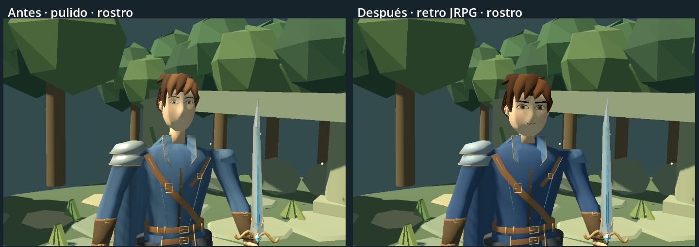
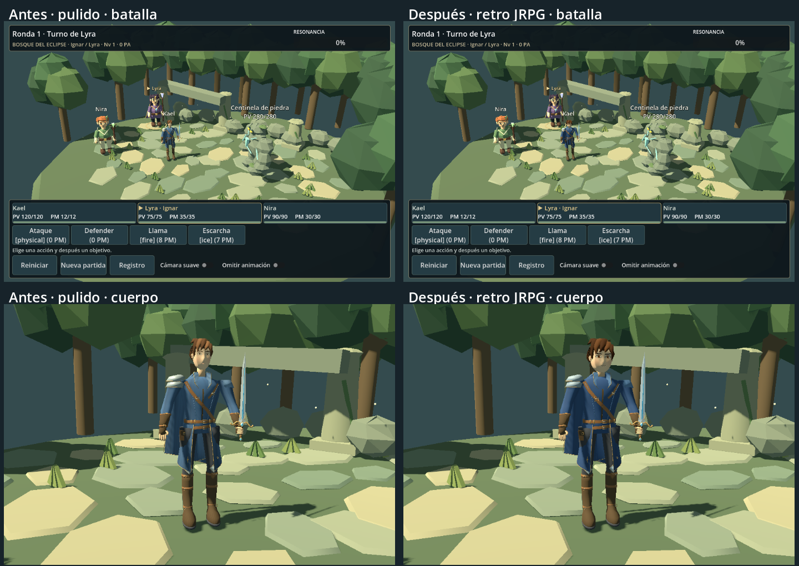

# Kael: dirección JRPG retro-modernizada

La variante activa es **`retro`**, creada editando la fuente guardada `polished/kael.blend`. Se conserva esa versión anterior intacta. No se reconstruye el personaje ni se sustituye por primitivas: permanecen la topología, vestimenta, espada, UV de base, pesos, rig y seis Actions.

El cambio más claro es una cara menos alargada, ojos y cejas legibles y materiales con menos ruido. La mejora se aprecia especialmente en rostro/cuerpo y es **más discreta desde la cámara lejana de combate**. No se presenta esta revisión como un personaje comercial terminado ni como una garantía de calidad artística aceptada por el diseñador.

## Comparación real





- [Captura inicial antes de editar](previews/kael-retro/initial-battle.png).
- Batalla: [antes](previews/kael-retro/before-battle-960x640.png) / [después](previews/kael-retro/after-battle-960x640.png).
- Revisiones adicionales: [1280×720](previews/kael-retro/after-battle-1280x720.png), [800×450](previews/kael-retro/after-battle-800x450.png).
- [Rostro](previews/kael-retro/after-face-torso.png), [cuerpo](previews/kael-retro/after-full.png), [perfil](previews/kael-retro/after-profile.png), [espalda](previews/kael-retro/after-back.png).
- [Exploración normal](previews/kael-retro/after-exploration.png), [caminando con cámara de detalle](previews/kael-retro/after-exploration-walk.png).
- [Ataque preparado](previews/kael-retro/after-attack-30.png), [corte](previews/kael-retro/after-attack-55.png), [recuperación](previews/kael-retro/after-attack-72.png), [defensa](previews/kael-retro/after-defend.png), [daño](previews/kael-retro/after-hurt.png), [KO](previews/kael-retro/after-ko.png).
- [Vídeo de los seis clips](previews/kael-retro/motion.mp4), grabado en Godot, 960×640 a 30 FPS. El vídeo usa el visor de estudio; las capturas de batalla usan las luces del escenario. Walk se muestra en el sitio en el vídeo y con movimiento físico real en la captura de exploración.

Las parejas conservan cámara, resolución, iluminación y escala de instancia. La malla incorpora los cambios de proporciones. No se han acercado las cámaras de juego ni cambiado luces para aparentar mejora. Los primeros planos se identifican como vistas de detalle. La fase del paso en exploración puede variar según el tiempo de render.

## Inspección previa

Antes de editar, se verificó `res://assets/characters/kael/polished/kael.glb` como asset activo; sus fuentes eran `kael.blend` y `kael_atlas.png` de la misma carpeta. Se ejecutaron **624 comprobaciones, cero fallos**, se capturó la batalla y se inspeccionaron mallas, componentes, rig y Actions en Blender.

Blender **5.2.1 LTS se ejecutó realmente** mediante CLI local, con procesos separados. La conexión MCP no estaba disponible. No se sustituyó una escena abierta del usuario ni se usaron servicios externos de generación.

Alturas de las AABB de las mallas de los actores en Godot (incluyen accesorios; no son mediciones anatómicas ni del skin en cada fotograma):

| Actor | Antes | Después |
|---|---:|---:|
| Kael | 2,20599 | 2,20478 |
| Lyra | 2,28846 | 2,28846 |
| Nira | 2,20254 | 2,20254 |
| Centinela | 2,53466 | 2,53466 |

No hacía falta aumentar otra vez la altura total. Se cambió su distribución visual manteniendo una escala coherente con el grupo.

## Cambios realizados

`tools/blender/style_kael_retro.py` abre exclusivamente la fuente `polished`. `edit_mesh()` identifica piezas ya existentes por conectividad, pesos y atlas. No llama a generadores de anatomía, ropa o armas.

- **Proporciones:** cabeza un 20 % más ancha y un 10 % más profunda. Se comprime la mitad inferior del rostro y se ajusta su altura y posición para reducir la sensación de cara/cuello alargados. El torso gana un 6 % de ancho en su zona central; brazos, piernas, manos, espada y articulaciones mantienen su colocación funcional. No se añade musculatura ni se acorta todo el cuerpo hacia proporciones chibi.
- **Mirada:** apertura vertical de ojos ampliada con ajuste del párpado superior interior; iris y pupilas mayores, cejas más definidas y menos arqueadas. `BVHTree` reproyecta las piezas existentes sobre la cara modificada para evitar que queden enterradas o separadas de la piel. La primera prueba daba una expresión sorprendida; se corrigieron iris, párpados y cejas tras revisar la captura.
- **Nariz y boca:** se reduce la proyección de la nariz; boca, labio inferior y marcas nasales se recolocan sobre la nueva superficie. La boca conserva una expresión sobria, sin añadir un rig facial.
- **Cabello:** se mantiene la silueta de mechones del diseño actual. Se oscurece hacia castaño y se atenúan las vetas finas, conservando volúmenes de color grandes.
- **Vestuario:** azul principal más profundo, solapas diferenciadas, cuero conservado y menos contraste de alta frecuencia en telas y adornos. No se eliminan las prendas características ni se añaden accesorios pequeños.
- **Metal:** metallic 0,30, roughness 0,65 y specular IOR 0,22, con un matiz de acero más frío. Se conserva el cristal de la espada. Materiales iluminados, sin soluciones unshaded ni luces nuevas por personaje.

`clean_atlas()` trata el PNG de `polished` como sRGB ya corregido: no repite la conversión de la iteración anterior. Filtra cada celda por separado para evitar mezcla entre colores, conserva la textura 1024 y empaqueta una imagen nueva. Las pruebas comprueban que el PNG realmente incrustado en GLB coincide con la fuente revisada.

## Animaciones e integración

Se revisaron **Idle, Walk, Attack, Hurt, Defend y KO** en capturas y en el vídeo. Se conservan sus duraciones y el trabajo de la iteración anterior:

| Clip | Duración | Resultado de esta revisión |
|---|---:|---|
| Idle | 3 s | Respiración y postura conservadas; la nueva cara sigue al hueso de cabeza |
| Walk | 0,6 s | Conserva trayectoria de apoyo y velocidad de reproducción 1,2× al desplazarse a 4 m/s |
| Attack | 0,8 s | Conserva preparación, corte exterior y recuperación; no se mueve la espada dentro del cuerpo para acomodar la cabeza |
| Hurt | 0,4 s | Reacción conservada |
| Defend | 0,4 s | Conserva brazos flexionados y espada elevada |
| KO | 1 s | Se recalcula el apoyo de la geometría modificada mediante claves de raíz |

No se atribuyen seis animaciones nuevas a esta entrega. `keep_ground_contact()` verifica las Actions guardadas y corrige la raíz cuando la geometría cambia el apoyo. El reposo del esqueleto se conserva; no se retargetean brazos o piernas ni se alteran las reglas del combate. El runtime sigue reproduciendo claves horneadas, sin IK o recorridos de vértices por frame.

Las pruebas evalúan el skin importado de Walk y KO a 120 muestras/s, entre las claves de 60 Hz. Mínimos finales respecto al plano: **Walk +0,000962 m**, **KO +0,005926 m**. Esta prueba no garantiza contacto perfecto con cada piedra del escenario ni ausencia de toda autocolisión de ropa durante mezclas.

`BattleActorVisual._build_imported_kael()` centraliza la selección `retro` para combate y exploración. Ambas instancias usan el mismo archivo y escala unitaria. Se conservan la corrección visual de apoyo de la cápsula, orientación, movimiento, mezcla de locomoción y cancelación al reiniciar de la iteración anterior.

## Presupuesto y móvil

| Medida | Polished | Retro |
|---|---:|---:|
| Triángulos | 12 297 | 12 297 |
| Vértices de autor | 8 184 | 8 184 |
| Vértices exportados | 14 830 | 14 830 |
| Superficies / materiales | 5 / 3 | 5 / 3 |
| Huesos | 17 | 17 |
| Atlas | 1024×1024 | 1024×1024 |
| GLB | 1 759 468 bytes | 1 417 820 bytes |
| PNG fuente | 812 453 bytes | 470 726 bytes |

El GLB ocupa aproximadamente un 19 % menos porque el atlas más limpio comprime mejor. **Eso no reduce por sí solo la memoria de la textura en GPU**. Una RGBA8 1024² ocupa 4 MiB sin mipmaps o ~5,33 MiB con cadena completa. Atributos e índices glTF suman aproximadamente 0,81 MiB: estimación base de geometría y textura ~6,2 MiB, excluyendo duplicados CPU/GPU, estructuras de Godot, animaciones por instancia y render targets.

Se conservan cinco superficies, hasta cinco envíos en el pase principal, más los pases de sombra que correspondan. No hay luces adicionales, nuevas superficies ni huesos. Siguen los materiales de doble cara de la fuente y el rig sencillo de capa/cabello. **No se ha medido Android ni iOS; no se declara cumplido el objetivo de 30 FPS en gama media.**

## Validación y archivos

**647 comprobaciones, cero fallos**, headless y render real en Godot 4.7.2 Compatibility / Intel Arc. Se conservan las 624 anteriores y se añaden 23 en `tests/kael_retro_checks.gd`: trazabilidad, fuente anterior intacta, PNG embebido, dimensiones reales importadas de cara/ojos por UV, presupuesto, reposo del rig, clips, apoyo entre claves, instancias, transición de parada, reinicio y uso del mismo GLB en ambos contextos. Las pruebas anteriores siguen cubriendo fallback y reglas.

Registros: [antes](previews/kael-retro/validation-before.txt), [headless final](previews/kael-retro/validation-headless.txt), [render final](previews/kael-retro/validation-native.txt), [Blender/reexportación](previews/kael-retro/validation-blender.txt). Se reabrió el `.blend` y se verificó la reexportación del mismo GLB. Capturas revisadas a 960×640, 1280×720 y 800×450, además de rostro, perfil, espalda y poses.

Archivos de la entrega:

- `assets/characters/kael/retro/`: fuente Blender, GLB, atlas, manifiesto e importación. `.blend` usa importer `keep`; Blender no es necesario para ejecutar el juego.
- `tools/blender/style_kael_retro.py`: `head_shape`, `edit_mesh`, `clean_atlas`, `keep_ground_contact`, `export`.
- `project.godot`, `scenes/battle_actor_visual.gd`: selección de la variante.
- `scenes/kael_retro_preview.tscn` y ajuste del visor compartido: comparación con `polished`, clips y acceso a batalla/exploración.
- `tools/capture_kael_polish.gd`, `tools/capture_kael_motion.gd`: opción `--retro`; conservan sus modos anteriores.
- `tests/kael_retro_checks.gd`, `tests/test_battle.gd`: cobertura adicional.
- Este informe, README, GDD, AGENTS y evidencias en `docs/previews/kael-retro/`.

No se cambian motor de combate, datos, historia, misiones, diálogos, personajes restantes ni escenario principal.

## Cómo probar y continuar

Detener la ejecución vieja con **F8** y arrancar con **F5**. Para combate, abrir `scenes/battle_3d.tscn` y pulsar **F6**. Para comparar modelos y revisar clips, abrir `scenes/kael_retro_preview.tscn` con **F6**. Cambiar `visuals/kael/asset_version` a `polished` recupera la versión anterior en ambos modos.

```powershell
# Con los ejecutables locales asignados a $blender y $godot:
& $blender --background --factory-startup --python-exit-code 1 --python tools/blender/style_kael_retro.py -- --export-only
& $godot --headless --editor --path . --import
& $godot --headless --path . --script res://tests/test_battle.gd
& $godot --path . --script res://tests/test_battle.gd
& $godot --path . --script res://tools/capture_kael_polish.gd -- --retro
& $godot --path . --script res://tools/capture_kael_motion.gd --write-movie "$env:TEMP/kael-retro.avi" --fixed-fps 30 -- --retro
```

`--export-only` preserva los retoques manuales guardados en `retro/kael.blend`. Sin esa opción se vuelve a abrir `polished/kael.blend` y se reaplica el estilo, sobrescribiendo únicamente la variante `retro`. Conservar una copia antes de reconstruirla si ha recibido trabajo manual.

## Valoración artística y límites

La cabeza más ancha, la mirada visible y la menor cantidad de detalle fino acercan el modelo al lenguaje de JRPG solicitado. Desde la cámara de combate, el cambio de proporciones es deliberadamente moderado; no supone una renovación equivalente del escenario ni de Lyra/Nira. La mejora de cara es más evidente en cuerpo completo y detalle.

Persisten limitaciones: expresión estática, boca pequeña, facciones y mechones aún simples, manos/hombros con deformación básica, capa rígida y paso amplio. En giros/frenadas puede quedar deslizamiento residual; no se ha incorporado apoyo dinámico sobre terreno ni detección exhaustiva de clipping. Las sombras del entorno siguen siendo marcadas sobre el rostro. No se ocultan estos límites con una iluminación exclusiva del personaje.

**Recomendación:** esta variante puede servir de referencia provisional de proporciones, paleta y simplicidad, pendiente de la revisión del diseñador. No conviene replicarla todavía como estándar final de acabado para todos los protagonistas: primero hay que aceptar la cara y el movimiento en juego. La validación técnica está completa en el escritorio probado; la aprobación artística y el rendimiento móvil siguen pendientes.
