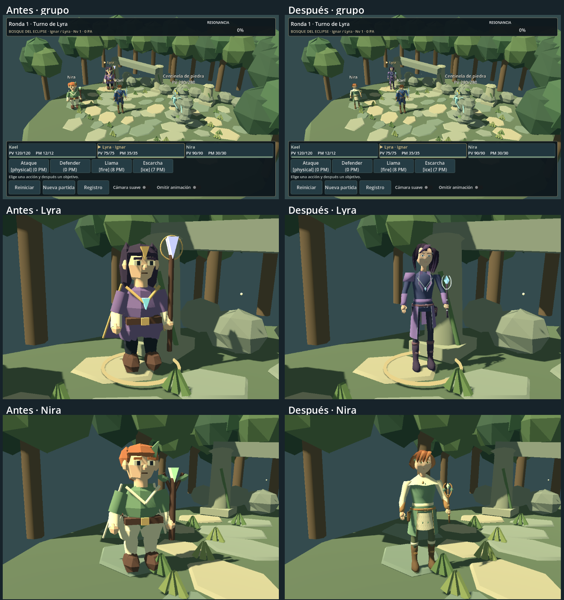

# Lyra y Nira: personajes del mismo grupo

Lyra y Nira usan ahora sus propios **GLB con malla, atlas, esqueleto y siete animaciones**, activados en la batalla 3D. La referencia es el Kael `retro` actual: proporciones estilizadas, colores amplios, materiales mates y detalles que se lean a distancia. No se copia su cuerpo ni se cambian sus archivos de arte.

La comparación muestra una mejora importante frente a las figuras anteriores: cabezas menos angulosas, manos separadas, botas y ropa con perfiles propios y siluetas menos compactas. Ambas encajan mejor con las proporciones del Kael actual. El resultado sigue siendo un acabado sencillo de prototipo retro; las caras y los gestos necesitan más trabajo antes de considerarlo arte comercial definitivo. La aprobación estética corresponde al diseñador y no se deduce de las pruebas técnicas.

## Comparación real en Godot



La lámina se compone dentro de Godot a partir de capturas de su viewport. Cada pareja conserva cámara, resolución, iluminación y escala de instancia. No se cambian el bosque, el Centinela ni las luces para favorecer los modelos nuevos. Las vistas individuales acercan la cámara para revisión; las capturas de batalla mantienen la cámara habitual.

- Cuerpos completos: [Lyra](previews/companions/after-lyra-full.png), [Nira](previews/companions/after-nira-full.png).
- Rostros: [Lyra](previews/companions/after-lyra-face.png), [Nira](previews/companions/after-nira-face.png).
- Grupo desde la cámara de combate: [960×640](previews/companions/after-battle-960x640.png), [1280×720](previews/companions/after-battle-1280x720.png), [800×450](previews/companions/after-battle-800x450.png).
- Acciones del motor presentadas en la cola normal de batalla: [Llama](previews/companions/lyra-event-battle.png), [Escarcha](previews/companions/lyra-event-ice.png), [Cura](previews/companions/nira-event-battle.png), [resultado de curación](previews/companions/nira-heal-result.png) e [Impulso](previews/companions/nira-event-haste.png).
- Detalle de poses: [Cast de Lyra](previews/companions/lyra-cast.png), [Support de Nira](previews/companions/nira-support.png), [KO de Lyra](previews/companions/lyra-ko.png), [KO de Nira](previews/companions/nira-ko.png). En la misma carpeta están Walk, Attack, Hurt y Defend de ambas.
- [Vídeo de los catorce clips renderizado en Godot](previews/companions/motion.mp4), 28 segundos, 960×640 a 30 FPS de captura. Usa las luces y el escenario de batalla con cámara de detalle. Walk se muestra en el sitio; no es una medición de rendimiento.

Las capturas `before-*` conservan los modelos procedurales anteriores; `after-*` usa los GLB. La comparación lejana sirve para evaluar el conjunto, pero no permite juzgar por sí sola los detalles de cara o manos.

## Diseños

**Lyra** tiene una silueta vertical y ligera, chaqueta índigo con solapas violetas, faldones separados, pantalones y botas altas de viaje. La banda de cintura, bolsa lateral y detalle de plata/cristal aportan lectura de maga aventurera sin añadir armadura de guerrera. El cabello oscuro violáceo tiene mechones laterales largos y una recogida asimétrica. Su foco de plata es cosmético: no cambia estadísticas, objetivos, alcance o habilidades. El lanzamiento eleva el foco y abre la mano libre.

**Nira** es algo más baja y ancha, con túnica salvia, sobreprenda abierta, paño frontal crema, envoltura de hombros, brazales de cuero y botas prácticas. El cabello cálido es corto y ondulado, con recogida baja. Los motivos de hojas y el foco de madera diferencian su identidad; no se añaden símbolos religiosos ni historia. Support mantiene los brazos más cerca del cuerpo y usa un gesto más contenido que Cast. No es la geometría de Lyra recoloreada: sus contornos, proporciones, peinado, prendas y accesorios son distintos.

Los tres comparten materiales iluminados y mates, contraste moderado, ojos y cejas simplificados y ropa por capas. Kael conserva una silueta más armada y azul; Lyra aporta verticalidad y tonos fríos; Nira, anchura y tonos naturales. En las revisiones se acortó la parte inferior de las caras, se despejó el flequillo de Lyra y se dio más volumen visible al cabello de Nira. No se implementa un sistema facial.

## Inspección y método de creación

Antes de editar se revisaron el GLB `assets/characters/kael/retro/kael.glb`, sus fuentes, rig y seis clips; la representación anterior de Lyra/Nira en `StylizedModels.hero()`; el adaptador de Kael, la batalla y la exploración. Se ejecutó la suite anterior: **647 comprobaciones, cero fallos**. La exploración solo representa físicamente a Kael; esta entrega no incorpora seguidores.

Se ejecutó realmente **Blender 5.2.1 LTS** mediante un proceso local `--background --factory-startup --python-exit-code 1`. La conexión MCP de Blender no estaba disponible. El proceso de construcción es independiente de cualquier escena abierta del usuario.

`tools/blender/build_companions.py` construye mallas originales mediante contornos anatómicos y de prendas, superficies conectadas, mechones curvos, UV y pesos. Reutiliza `Surface` y las utilidades de curvas de `kael_reference_mesh.py` como herramientas de escritura de geometría. No carga ni duplica el cuerpo de Kael, ni construye figuras mediante nodos de primitivas de Godot. Es **modelado algorítmico local**, no escultura manual ni un modelo generado por un servicio externo. La petición de aplicar el enfoque probado de Kael a estas dos protagonistas delimita esta iteración; no implica aprobar cualquier sustitución procedural futura.

Las funciones `torso()`, `coat()`, `limbs()`, `head()`, `hair()` y `focus()` definen las piezas. `style_face_proportions()` ajusta los vértices vinculados a cabeza/cuello. `materials()` genera un atlas determinista de colores y matices suaves, con paleta sRGB. No se presenta como textura pintada a mano. Cada modelo utiliza dos mallas, cuerpo y foco, y tres materiales sencillos: tela/piel, metal y cristal. No hay transparencia de cabello ni shaders personalizados.

`rig_create()` crea un esqueleto propio de 17 huesos con los nombres compatibles con el adaptador existente. `pose()` y `animate()` hornean rotaciones y posiciones a 60 Hz; la resolución de las cadenas de brazos y piernas ocurre en Blender, sin IK adicional en tiempo de juego. `min_z()` evalúa la malla deformada y corrige el apoyo de la raíz al construir los clips. `export()` guarda un GLB autocontenido, con PNG incrustado, y un manifiesto con recuentos y hashes.

Las primeras pruebas detectaron que el exportador añadía 1/60 s al inicio de cada clip. Se corrigió con `export_anim_slide_to_zero=True`, conservando las Actions guardadas. La duración importada coincide ahora con la tabla de presentación. Se reabrieron ambos `.blend` y se repitió la exportación corregida: los GLB resultantes coinciden byte por byte con los entregados. [Registro de construcción](previews/companions/blender-build.log) y [reapertura/reexportación final](previews/companions/blender-reexport.log); el primer registro conserva los hashes previos a esta corrección, los manifiestos y el segundo reflejan la entrega final.

Fuentes y exportaciones:

| Personaje | Fuente editable | Exportación | Textura y trazabilidad |
|---|---|---|---|
| Lyra | `assets/characters/lyra/lyra.blend` | `assets/characters/lyra/lyra.glb` | `lyra_atlas.png`, `lyra_manifest.json` en la misma carpeta |
| Nira | `assets/characters/nira/nira.blend` | `assets/characters/nira/nira.glb` | `nira_atlas.png`, `nira_manifest.json` en la misma carpeta |

Los manifiestos identifican las fuentes, atlas, GLB, constructor, helper y GLB de referencia de Kael por SHA-256. Kael `retro` conserva el hash `6ab01c49f53adfc028525238511be74673d1bfdc42deca73dfae15032227f93f`. No se descargan modelos, texturas o animaciones de terceros y no se envían datos a servicios externos.

## Animación e integración

| Clip | Lyra | Nira | Uso |
|---|---:|---:|---|
| Idle | 3 s | 3 s | Respiración y reposo, bucle |
| Walk | 0,7 s | 0,7 s | Paso en bucle; disponible para revisión, sin añadir personajes a exploración |
| Attack | 0,65 s | 0,65 s | Acción básica con foco cosmético |
| Hurt | 0,4 s | 0,4 s | Reacción al daño |
| Defend | 0,45 s | 0,45 s | Pose mantenida de defensa |
| KO | 1 s | 1 s | Caída y pose final mantenida |
| Cast | 0,85 s | — | Llama y Escarcha; las distingue el VFX existente |
| Support | — | 1 s | Cura e Impulso; las distingue el VFX existente |

`scenes/companion_model.gd` extiende el adaptador ya probado y define las rutas de ambos GLB, el nodo `Focus`, los clips requeridos y `clip_for_effect()`. Cast/Support vuelven a la pose base al terminar. `scenes/kael_model.gd` solo añade puntos pequeños de extensión para nombres, requisitos y correspondencia de efectos; su comportamiento predeterminado y sus assets se conservan.

`BattleActorVisual._build_imported_companion()` carga el recurso, conserva el error si falla y permite volver a `StylizedModels.hero()`. `animate()` y `presentation_duration()` consultan la correspondencia del modelo. La presentación respeta la duración del clip, mantiene los estados de defensa/KO y permite cancelar/reiniciar. El motor sigue resolviendo los efectos mediante los mismos eventos y reglas; los focos no se añaden al sistema de combate.

Los ajustes `visuals/lyra/use_imported=true` y `visuals/nira/use_imported=true` activan los modelos en el arranque normal. Cambiar cualquiera a `false` y reiniciar devuelve solo ese personaje al modelo anterior. Una ruta explícita inválida también conserva el fallback. Los GLB se importan con `gltf/embedded_image_handling=3`; los `.blend` se conservan como fuente, con importación directa de Blender desactivada.

Escala de instancia unitaria y orientación compartida con el adaptador del grupo. Lyra se ha diseñado alrededor de 2,1 unidades de altura y Nira de 2,0; son dimensiones artísticas, no tallas narrativas. El foco y el peinado pueden ampliar la caja envolvente. El contacto de cada clip se evalúa contra un plano, no contra cada piedra irregular del escenario.

## Presupuesto gráfico

| Medida | Lyra | Nira | Kael retro, referencia intacta |
|---|---:|---:|---:|
| Triángulos | 8.607 | 9.019 | 12.297 |
| Vértices de autor | 5.696 | 6.129 | 8.184 |
| Vértices exportados | 9.096 | 9.846 | 14.830 |
| Mallas | 2 | 2 | 2 |
| Superficies / materiales | 6 / 3 | 5 / 3 | 5 / 3 |
| Huesos / clips | 17 / 7 | 17 / 7 | 17 / 6 |
| Atlas | 1 × 1024² | 1 × 1024² | 1 × 1024² |
| GLB | 768.592 bytes | 826.760 bytes | 1.417.820 bytes |
| Fuente Blender | 588.470 bytes | 615.785 bytes | Conservada |
| PNG separado | 136.075 bytes | 154.731 bytes | 470.726 bytes |
| Atributos e índices glTF únicos | 524.634 bytes | 566.106 bytes | ≈0,81 MiB |

El recuento exportado incluye separaciones de UV/normales/materiales; no equivale al número de vértices editables en Blender. La medida de atributos e índices suma los accessors únicos utilizados por las primitivas; excluye animaciones, skin y JSON.

Una textura RGBA8 1024² presupone **4 MiB sin mipmaps o unos 5,33 MiB con la cadena completa**, por personaje. Sumando los atributos e índices almacenados, la base aproximada es **5,84 MiB para Lyra y 5,87 MiB para Nira**. No es una medición de VRAM: faltan estructuras del motor, animaciones duplicadas por instancia, copias CPU/GPU, alineación y render targets. Un PNG o GLB pequeño no garantiza menor memoria en ejecución. Las seis/cinco superficies también implican coste de envíos y sombras.

Se cumplen los presupuestos orientativos de 8.000–15.000 triángulos y atlas de 1024. No hay sistema de LOD propio ni nuevas dependencias; Godot conserva su generación automática predeterminada al importar. Los recuentos corresponden a la malla base. **No hay medición en Android o iOS y no se afirma que se alcancen 30 FPS estables.**

## Pruebas y reproducción

Validación final: **777 comprobaciones, cero fallos**, tanto [headless](previews/companions/tests-headless.log) como [con render real](previews/companions/tests-render.log), conservando las [647 anteriores](previews/companions/before-tests.log). `tests/companion_asset_checks.gd` añade 130 comprobaciones de importación real, fuente/atlas/manifiestos, PNG incrustado, rig y clips, presupuesto/materiales/pesos, apoyo del skin, correspondencia de eventos, independencia de instancias, estados, reinicio, cola asíncrona completa y fallback. Las suites históricas `visual_refresh_checks.gd` y `kael_asset_checks.gd` se ejecutan con Lyra/Nira procedurales solo durante esas llamadas, porque verifican expresamente sus antiguas capas y el piloto exclusivo de Kael. Se restauran los ajustes y las pruebas nuevas cubren los GLB activados; no se retiran sus aserciones.

El skin importado se muestrea a 120 Hz, incluyendo interpolación entre claves: mínimos de Walk **+0,010017 m en Lyra y +0,009427 m en Nira**; KO **+0,007924 m** en ambas. Los catorce clips modifican realmente el esqueleto, los bucles no saltan al reiniciarse y las acciones respetan su duración. Esto verifica apoyo contra un plano, no autocolisiones completas ni rendimiento móvil. Las capturas y el vídeo se inspeccionaron por separado para revisar silueta, escala, foco, caras y deformaciones.

Para verlo en el editor: detener la ejecución anterior con **F8**, abrir `scenes/battle_3d.tscn` y pulsar **F6**. Lyra actúa primero: Llama/Escarcha reproducen Cast. Al llegar el turno de Nira, Cura/Impulso reproducen Support. F5 mantiene la exploración y el acceso habitual al combate, con Kael como único personaje visible en campo.

Desde la raíz del repositorio en PowerShell:

```powershell
$blender = 'C:\Program Files\Blender Foundation\Blender 5.2\blender.exe'
$godot = 'C:\Users\aleja\Downloads\Godot_v4.7.2-stable_win64.exe\Godot_v4.7.2-stable_win64_console.exe'
# Reexportar las fuentes guardadas, conservando retoques manuales:
& $blender --background --factory-startup --python-exit-code 1 --python tools/blender/build_companions.py -- --export-only
& $godot --headless --path . --editor --import
& $godot --headless --path . --script res://tests/test_battle.gd
# Validación con render real:
& $godot --path . --script res://tests/test_battle.gd
& $godot --path . --script res://tools/capture_companions.gd
# Vídeo real: AVI temporal, después conversión con FFmpeg local.
& $godot --path . --script res://tools/capture_companion_motion.gd --write-movie "$env:TEMP\companions-motion.avi" --fixed-fps 30
& "$env:USERPROFILE\.local\bin\ffmpeg.exe" -y -i "$env:TEMP\companions-motion.avi" -an -c:v libx264 -crf 20 -pix_fmt yuv420p -movflags +faststart docs/previews/companions/motion.mp4
```

Los comandos deben terminar con código 0. La captura necesita ventana/render real; el script rechaza headless y comprueba la ruta de los GLB. Los ajustes de comparación se cambian solo en memoria y no se guardan en el proyecto.

Para **reconstruir** deliberadamente desde el script, omitir `-- --export-only`; esto sobrescribe las fuentes, atlas y GLB de ambas protagonistas y descarta retoques manuales no trasladados al constructor. `-- --hero lyra` o `-- --hero nira` limita la reconstrucción; puede combinarse con `--export-only`. El usuario puede editar la fuente guardada en Blender y reexportarla sin regenerar geometría. Si pinta el atlas, debe recargar y empaquetar la imagen en la fuente antes de exportar.

## Límites pendientes

- Caras de expresión fija, nariz y mejillas simplificadas; la mirada y la boca todavía necesitan dirección artística más fina. No hay lip sync, expresiones, blend shapes ni huesos faciales.
- El atlas repite zonas de color y gradientes; falta pintura específica de rostro y prendas. Los materiales y algunos bordes muestran el origen algorítmico en primer plano.
- Pelo y paños están ligados al rig básico, sin huesos secundarios ni simulación. Manos con dedos modelados, pero sin articulación individual. El brazo de apoyo y la inclinación de muñeca siguen siendo simples.
- Las poses revisadas mantienen el foco fuera del torso y el apoyo general; no se certifica ausencia de toda autointersección en cada mezcla o ángulo. La deformación de hombros, codos y envoltura de Nira admite pulido. Walk es una animación disponible, no una mecánica nueva de seguidores.
- El detalle se pierde desde la cámara habitual. Su equivalencia se valora contra el Kael actual, cuyo acabado también sigue siendo de prototipo; no contra una ilustración de referencia o una producción comercial terminada.
- El rendimiento móvil y la aceptación artística final siguen pendientes. No se modifica la historia, misión, diálogo, BattleEngine, datos, Resonancia, Guardianes, escenario ni Centinela.
