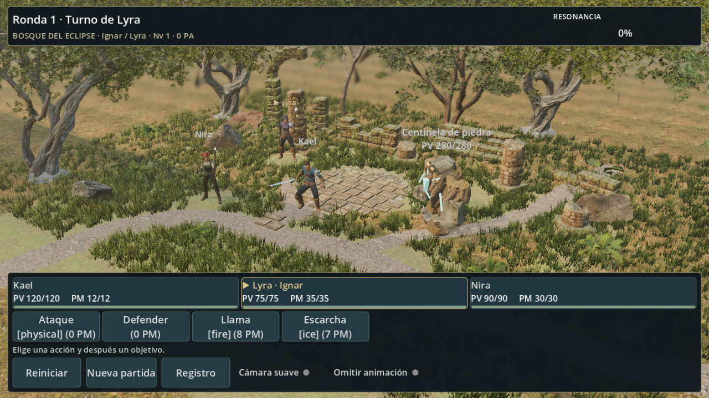

# Grupo HD (iteración 1.4): Kael, Lyra y Nira semirrealistas

Los tres protagonistas pasan a la misma dirección semirrealista que el bosque HD. Se montan con piezas de **Quaternius**: cabeza del cuerpo base, traje, peinado y animaciones. Cada uno tiene colores propios y un arma o foco modelado en el proyecto. Se activa con `visuals/party/style="hd"`, que es el valor predeterminado. No cambian las reglas, las posiciones de combate, la física de exploración ni la historia.

## Por qué los archivos no están en Git

Los paquetes que se descargaron incluyen una licencia **CC0**. Sin embargo, la [licencia general actual de Quaternius (QAL)](https://quaternius.com/license.html) prohíbe redistribuir los modelos como archivos sueltos, y el repositorio es público. Por prudencia, todo lo derivado de estos paquetes se queda en `assets/third_party/`, carpeta que Git ignora. Esto incluye los paquetes originales y los modelos montados.

Lo que sí está en Git:
- el constructor (`tools/blender/build_party_hd.py`);
- el instalador (`tools/install_quaternius.py`);
- la integración (`KaelModel.styled_path`);
- las pruebas;
- capturas renderizadas en Godot.

Sin los paquetes, el juego usa los modelos actuales automáticamente y no muestra ningún error.

## Reproducir en otro equipo

1. Descarga a mano estos tres paquetes gratuitos en itch.io. En cada página pulsa *Download* y después «No thanks, just take me to the downloads»:
   - [Universal Base Characters](https://quaternius.itch.io/universal-base-characters)
   - [Modular Character Outfits – Fantasy](https://quaternius.itch.io/modular-character-outfits-fantasy)
   - [Universal Animation Library](https://quaternius.itch.io/universal-animation-library)
2. Instálalos con `python -I tools/install_quaternius.py "<zip1>" "<zip2>" "<zip3>"`. El instalador solo extrae modelos, texturas y textos. También crea un `.gdignore` para que Godot no importe los paquetes sin procesar.
3. Construye los modelos con `blender --background --factory-startup --python-exit-code 1 --python tools/blender/build_party_hd.py`. Tarda unos 3 minutos.
4. Importa con `godot --headless --path . --import`.

## Qué hace el constructor

Los tres paquetes comparten un esqueleto de 65 huesos. Para cada héroe, el constructor:

- importa el traje y conserva solo la cabeza y el cuello del cuerpo base (el traje está pensado para llevarse así);
- añade el peinado, que ya viene unido al hueso de la cabeza;
- reduce las texturas a 2048 px;
- recolorea el traje: rota solo los tonos verdes de la tela, de modo que el cuero y el metal se mantienen como estaban pintados. El pelo se tiñe por luminancia;
- modela el arma o el foco y lo encaja en el puño de una pose de la biblioteca. Después lo une al hueso de esa mano;
- crea los clips que exige el adaptador mezclando segmentos de la biblioteca con NLA de Blender, con transiciones;
- escala el modelo, medido en reposo, a la altura que ya tenía cada héroe en el juego (2,15 / 2,05 / 1,93);
- exporta un glTF con las texturas en archivos aparte. Godot las importa comprimidas y con mipmaps, que es lo aprendido en el bosque HD. El constructor deja un manifiesto con métricas y el hash del archivo.

| Héroe | Traje | Pelo | Color | Arma o foco | Triángulos |
|---|---|---|---|---|---:|
| Kael (guerrero) | Ranger hombre, sin capucha, hombrera | Raya al lado, castaño oscuro | Tela verde → azul | Espada de acero con guarda de latón, mano derecha | 31 185 |
| Lyra (maga) | Ranger mujer, sin capucha | Largo, violeta oscuro | Tela verde → índigo violáceo | Bastón oscuro con tres puntas de plata y cristal violeta emisivo, mano izquierda | 33 448 |
| Nira (sanadora) | Peasant mujer, variante salvia | Moños, cobrizo | Variante 2 del paquete | Vara de madera con hojas talladas y cristal verde, mano izquierda | 22 566 |

### Clips

| Clip | Kael | Lyra / Nira |
|---|---|---|
| Idle | Sword_Idle (guardia) | Idle_Torch_Loop (puño izquierdo alzado; el bastón queda vertical) |
| Walk | Jog_Fwd_Loop | Jog_Fwd_Loop |
| Attack | Sword_Attack | Punch_Jab con la mano del bastón (estocada con el bastón) |
| Hurt | Hit_Chest → reposo | Hit_Chest → reposo |
| Defend | reposo → agachado en guardia | reposo → agachado en guardia |
| KO | Death01 | Death01 |
| Cast (Lyra) | — | Spell_Simple (entrada, disparo, salida) → reposo |
| Support (Nira) | — | Spell_Simple (entrada, mantenido, salida) → reposo |

Los bastones van en la mano izquierda por dos motivos. En la pose de antorcha la derecha cuelga abierta, y los hechizos de la biblioteca se lanzan con la izquierda, así que el bastón acompaña el gesto. Caminar usa el trote: la exploración mueve a 4 m/s y la reproducción se limita a 2,5×. Con el paso tranquilo de la biblioteca (~1,1 m/s a escala) los pies patinarían. Con el trote (~6 m/s a escala) se reproduce a ~0,65× sin patinar.

## Capturas (render real en Godot)

- Grupo: [vista cercana](previews/party-hd/hd-party.png); combate a [1280×720](previews/party-hd/hd-battle-1280x720.png) y [960×640](previews/party-hd/hd-battle-960x640.png).
- Cuerpo y cara: [Kael](previews/party-hd/hd-kael-full.png) / [cara](previews/party-hd/hd-kael-face.png), [Lyra](previews/party-hd/hd-lyra-full.png) / [cara](previews/party-hd/hd-lyra-face.png), [Nira](previews/party-hd/hd-nira-full.png) / [cara](previews/party-hd/hd-nira-face.png).
- Acciones: [ataque de Kael](previews/party-hd/hd-kael-attack-32.png), [Cast de Lyra](previews/party-hd/hd-lyra-cast-50.png), [Support de Nira](previews/party-hd/hd-nira-support-50.png), [ataque de Nira](previews/party-hd/hd-nira-attack-32.png), [Defend](previews/party-hd/hd-lyra-defend-100.png), [KO](previews/party-hd/hd-kael-ko-100.png).
- Exploración: [vista de juego](previews/party-hd/exploration/hd-1280x720.png), [Kael de cerca](previews/party-hd/exploration/hd-view-player.png).

Para regenerarlas: `godot --path . --script res://tools/capture_party_style.gd -- --only=hd --out=res://docs/previews/party-hd/`.

## Rendimiento (gráfica integrada, 1280×720)

| Escena | Modelos actuales | Grupo HD |
|---|---:|---:|
| Exploración | 39–44 FPS | ~38 FPS |
| Combate | 53–59 FPS | 52–55 FPS |

La diferencia cae dentro del ruido de medida, que ronda el ±10 % en este portátil. Son unos 90 000 triángulos en total y 65 huesos por personaje. Rendimiento móvil no medido.

## Pruebas

`tests/party_hd_checks.gd` se ejecuta al final de `tests/test_battle.gd`. Las suites hasta 1.3 se ejecutan con `party/style="current"`, igual que ya se hacía con `forest/hd=false`, sin debilitar ninguna aserción.

- **Siempre (4 comprobaciones):**
  - el proyecto arranca en `hd`;
  - los modelos de terceros están solo en la carpeta ignorada;
  - sin paquetes, cada héroe conserva su modelo actual;
  - los estilos `current` y `ps1` no cambian.
- **Con los paquetes instalados (40 comprobaciones más):**
  - hash del glTF;
  - importación sin fallback;
  - 65 huesos y mallas con piel;
  - arma unida a la mano correcta;
  - texturas comprimidas con mipmaps;
  - presupuesto;
  - altura en reposo medida sobre los vértices deformados;
  - zancada suficiente;
  - clips, bucles y duraciones;
  - KO/Defend mantenidos y reinicio;
  - en combate, las mismas órdenes producen el mismo estado del motor que con los modelos actuales, y se conservan posiciones, eventos y reinicio;
  - en exploración, Kael HD camina con la misma física y vuelve a Idle.

Total: **1038 comprobaciones, cero fallos** con los paquetes instalados (994 anteriores + 44). En un clon sin paquetes son 998.

## Límites

- Estilo «semirrealista estilizado» de Quaternius: proporciones y caras de videojuego moderno, no fotorrealismo. Encaja con el bosque mucho mejor que los modelos anteriores, pero no es arte final hecho a medida.
- Solo hay dos trajes en los paquetes gratuitos (Ranger y Peasant), así que Kael y Lyra comparten corte de ropa con colores distintos.
- Los dedos no se animan: el puño tiene la misma forma en todos los clips. En la guardia de Kael la espada queda baja y hacia un lado, que es la pose de la biblioteca.
- Las animaciones son genéricas de la biblioteca. No hay un gesto de defensa con arma; se usa una guardia agachada.
- Tamaño local de unos 420 MB de paquetes más ~100 MB de modelos montados, fuera de Git.
- Rendimiento móvil no medido.
