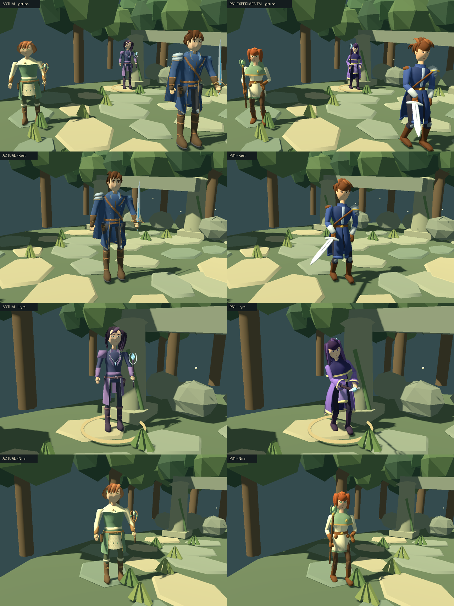

# Experimento artístico: protagonistas estilo modelo de combate PS1 (1.2)

Fecha: **9 de noviembre de 2026**. Estado: **variante experimental, NO activa por defecto**. `visuals/party/style = "current"` (por defecto) mantiene Kael `retro`, Lyra y Nira actuales. `"ps1"` carga las tres variantes nuevas en batalla y en exploración. Ningún asset, animación o prueba anterior se ha modificado ni eliminado.

Todas las imágenes son capturas reales de Godot 4.7.2 (Compatibility) con la misma escena de batalla, cámara, luz, escala y resolución. Otras láminas: [caras](previews/party-ps1/faces.png) · [batalla con HUD](previews/party-ps1/battle.png) · [poses](previews/party-ps1/poses.png) · [tira de movimiento](previews/party-ps1/motion-strip.png) · GIF en `previews/party-ps1/motion/`.

Probarlo: añadir `party/style="ps1"` en la sección `[visuals]` de `project.godot` y pulsar F5 (exploración) o F6 en `scenes/battle_3d.tscn`. Capturas: `godot --path . --script res://tools/capture_party_style.gd`.

## Estudio de referencia: qué hace funcionar a los modelos de combate de FFVII/FFVIII

Solo se estudian principios, sin copiar diseños.

- **Piezas rígidas por hueso.** Cada segmento del cuerpo es una pieza cerrada unida a un solo hueso. Las articulaciones se tapan con extremos redondeados y solapes, no con piel que se estira. Por eso los codos y las rodillas nunca se deforman mal.
- **Formas grandes:** hombreras, botas, guantes, mechones y armas sobredimensionados. El diseño se lee por la silueta y por manchas de color, no por detalles pequeños.
- **Cabeza algo mayor, cara pintada:** ojos grandes con línea superior gruesa, nariz y boca mínimas. La expresión está en la textura, no en la geometría.
- **Paletas reconocibles por personaje,** distinguibles desde una cámara lejana.
- **Postura de combate:** pies escalonados, rodillas flexionadas y arma lista. La pose de reposo ya comunica quién es el personaje.

## Guía común de proporciones y materiales

| | Kael | Lyra | Nira |
|---|---|---|---|
| Altura (cráneo) | 2,07 | 1,99 | 1,89 |
| Cabezas | ~5,7 | ~5,7 | ~5,6 |
| Hombros | anchos, en V | estrechos, verticales | medios, redondeados |
| Silueta | abrigo largo de cuatro paneles y hombrera de placas asimétrica | capelina de cuello alto, vestido-abrigo abierto, mangas acampanadas y melena larga | manto corto con capucha, túnica acampanada, bolsas y melena redondeada con trenza |

- **Proporciones:** cabeza = altura / 5,7; manos y botas un 15–25 % mayores que lo anatómico, para que se lean de lejos.
- **Secciones esculpidas,** no cilindros. Cada pieza tiene secciones elípticas asimétricas (delante y detrás distintos) con modulación radial: deltoides, gemelos, mandíbula, pómulos, nariz y pectorales.
- **Material:** uno por personaje, opaco y con iluminación estándar. Atlas de 512² con muestras de color pintadas (claras arriba y frías abajo, con trazos suaves) y la cara pintada en la mitad derecha. Cada vértice apunta a su muestra con un pequeño degradado a lo largo de la pieza, como el sombreado de vértices de PS1 pero más limpio.
- **Cara:** proyección frontal sobre la región pintada. Ojos con blanco, iris de dos tonos, pupila, brillo, párpado y pestaña superior gruesos, cejas, nariz en sombra y boca. Es diferente para cada personaje: iris ámbar en Kael, violeta en Lyra y verde en Nira; las inclinaciones y pestañas también cambian.

## Diseños (originales)

- **Kael:** guerrero joven con pelo castaño de raya lateral, flequillo barrido y mechones en punta hacia atrás. Abrigo azul marino largo, abierto por delante y con ribete claro, cuello alto, pechera clara, bandolera de cuero y hombrera de tres placas en un solo hombro. Brazales metálicos, guantes y botas de cuero con rodilleras. Espada larga de hoja ancha con acanaladura, guarda angular y pomo dorado. En reposo la sostiene baja y hacia delante.
- **Lyra:** maga con melena larga violeta oscura, dos mechones que enmarcan la cara y flequillo ladeado que deja ver los ojos. Capelina índigo de cuello alto con ribete crema y broche de cristal. Vestido-abrigo violeta de seis paneles con panel delantero claro. Mangas acampanadas con ribete, fajín dorado y bastón con cristal en media luna.
- **Nira:** sanadora con melena cobriza redondeada a la altura de la mandíbula, flequillo corto y trenza a un lado. Manto corto verde salvia con capucha y ribete dorado, alfiler de hoja, túnica crema acampanada con dobladillo verde, cinturón con dos bolsas, guantes y botas marrones. Bastón corto con hojas y cristal verde.

No se han copiado peinados, armas ni vestuarios de personajes existentes. Se han evitado expresamente la espada gigante y la cresta rubia de punta, el vestido rosa con trenza y la falda negra con tirantes.

## Herramientas, archivos y licencias

- `tools/blender/build_ps1_party.py` (Blender 5.2.1, proceso en segundo plano): genera rig, mallas, atlas, Actions y GLB. `-- --hero kael|lyra|nira` limita la construcción. `-- --export-only` reabre el `.blend` guardado y solo reexporta; se verificó que produce los mismos GLB byte a byte.
- `assets/characters/{kael,lyra,nira}/ps1/`: `.blend` (fuente), `.glb` (atlas incrustado, `embedded_image_handling=3`), `_atlas.png` y `_manifest.json`.
- Godot: `KaelModel.PS1_PATHS` y `KaelModel.party_style()`. Ni `BattleActorVisual` ni `CompanionModel` cambian de ruta mientras el estilo sea `current`. Una ruta explícita sigue teniendo prioridad.
- Todo es original y está generado localmente: geometría, cara pintada y atlas. Sin descargas, compras ni servicios externos.

## Presupuesto gráfico

Valores del manifiesto, comprobados contra la malla importada en Godot por `party_ps1_checks.gd`.

| | Triángulos | Vértices exportados | Superficies | Materiales | Textura | GLB | Huesos |
|---|---:|---:|---:|---:|---|---:|---:|
| Kael actual (`retro`) | 12.297 | 14.830 | 5 | 3 | 1024² | 1,42 MB | 17 |
| **Kael PS1** | **7.960** | **4.214** | **2** | **1** | **512²** | **0,41 MB** | 17 |
| Lyra actual | 8.607 | 9.096 | 6 | 3 | 1024² | 0,77 MB | 17 |
| **Lyra PS1** | **6.768** | **3.678** | **2** | **1** | **512²** | **0,38 MB** | 17 |
| Nira actual | 9.019 | 9.846 | 5 | 3 | 1024² | 0,83 MB | 17 |
| **Nira PS1** | **7.144** | **3.807** | **2** | **1** | **512²** | **0,39 MB** | 17 |

Memoria estimada por personaje, sin medir en dispositivo:
- **Textura:** ~1,4 MB RGBA con mipmaps (frente a ~5,6 MB del atlas de 1024).
- **Vértices:** ~0,2 MB.
- **Draw calls:** 2 por personaje (cuerpo y arma, un solo material), frente a 5–6 superficies de los actuales.

Sin transparencias ni shaders especiales. **Rendimiento móvil no medido.**

## Animaciones

Idle, Walk, Attack, Hurt, Defend y KO en los tres personajes, más Cast (Lyra) y Support (Nira). Se usan los mismos nombres, bucles y mapeo de eventos que en los modelos actuales, y la duración de presentación sale del manifiesto. Muestreadas a 30 Hz.

- **Idle:** postura de combate con respiración.
- **Kael Attack:** carga sobre el hombro, tajo en diagonal y vuelta a la guardia.
- **Ataques de Lyra y Nira:** golpe con el bastón.
- **Defend:** espada cruzada (Kael), bastón en diagonal (Lyra) o brazos protectores (Nira).
- **Cast (Lyra):** bastón en alto y palma abierta.
- **Support (Nira):** recoge las manos al pecho y las abre hacia arriba.
- **Hurt:** retroceso.
- **KO:** cae de rodillas y se desploma de espaldas.

La zancada (1,64–1,79 m/s de referencia) cubre los 4 m/s de exploración sin superar el límite de reproducción de 2,5×, así que los pies no resbalan. Ningún vértice, incluida el arma, atraviesa el suelo en ningún clip entre claves.

## Pruebas

- Antes: **820 comprobaciones, 0 fallos.**
- Después: **966 comprobaciones, 0 fallos.** Las 820 anteriores se mantienen y `tests/party_ps1_checks.gd` añade 146.

Cubre:
- **Trazabilidad:** GLB, `.blend`, atlas y script trazables por hash.
- **Atlas incrustado,** sin textura auxiliar extraída.
- **Importación** sin fallback, con los mismos 17 huesos que los modelos actuales.
- **Piezas rígidas:** un hueso por vértice, y el arma unida solo a `hand.R`.
- **Métricas y presupuesto:** coinciden con el manifiesto y respetan los límites.
- **Clips:** presentes, con bucles correctos y Idle/Walk sin salto. Mueven el esqueleto y respetan el apoyo en el suelo entre claves.
- **Estados KO y Defend** mantenidos.
- **Ruta ausente:** devuelve diagnóstico para el fallback.
- **Combate invariante:** las mismas órdenes dan el mismo estado de combate con ambos estilos.
- **Batalla:** mapeo de eventos, Cast y Support, KO por estado, y reinicio que conserva la variante y limpia la presentación.
- **Exploración:** Kael PS1 camina con la misma física.
- **Estilo por defecto:** `current` sigue siéndolo y volver a él recupera los tres modelos anteriores.

Las pruebas detectaron dos fallos reales que se corrigieron:
- **KO bajo el suelo:** el arma se hundía entre 6 y 14 cm porque el ajuste de altura solo medía el cuerpo.
- **Resbalón en exploración:** la zancada inicial (1,2 m/s) habría hecho resbalar los pies.

## Comparativa visual (evaluación sin ganador automático)

| Criterio | Actual | PS1 experimental |
|---|---|---|
| Carisma y cara | Rostros planos y algo apagados | **Mejor:** ojos grandes legibles, cejas con actitud y personalidad de JRPG de los 90 |
| Pelo y silueta de cabeza | Correcto pero discreto | **Mejor:** mechones grandes, siluetas inconfundibles (raya lateral, melena larga, bob con trenza) |
| Proporciones | ~7–7,5 cabezas, cuerpos finos | **Mejor para la referencia:** ~5,7 cabezas, manos y botas legibles, sin llegar al chibi |
| Lectura a distancia de batalla | Buena | Buena; colores de identidad más claros |
| Vestuario y detalle | **Mejor:** Kael con capa, correas y hebillas; Lyra con hombreras y ribetes; más acabado | Más simple: torsos planos, pocos accesorios y piezas visiblemente "por segmentos" de cerca |
| Materiales | Atlas de 1024 más rico | Muestras pintadas: limpias y coherentes, pero lisas de cerca |
| Animación | Correcta | Equivalente; postura de combate más expresiva y piezas rígidas sin deformaciones |
| Coste | 8,6–12,3k triángulos, 5–6 superficies | 6,8–8k triángulos, 2 superficies, textura cuatro veces menor |

**Recomendación: mantener los modelos actuales por defecto.** El experimento no es *claramente* superior en conjunto. Gana en carisma facial, pelo, proporciones de la referencia y coste, pero pierde en riqueza de vestuario y acabado de cerca. Si el diseñador prefiere la dirección PS1, el siguiente paso con más impacto sería **híbrido**: conservar cabeza, cara pintada, pelo, proporciones y piezas rígidas de esta variante, y trasladar el nivel de detalle del vestuario actual (correas, hebillas, capas y hombreras trabajadas) a piezas grandes.

## Limitaciones (lo que impide avanzar más)

- **Método:** todo se construye con scripts (secciones esculpidas definidas numéricamente). Sin modelado ni pintura a mano de un artista, los torsos y la ropa quedan geométricamente correctos pero sin la intención de diseño fina que tenían los modelos de 1997 (pliegues pintados, insignias, costuras). Es el límite principal; más iteraciones con este método darían mejoras pequeñas.
- **Cara proyectada de frente:** en perfil completo la textura se estira por los laterales (lo tapa el pelo en gran parte). No hay párpados ni expresiones variables.
- **Juntas rígidas:** de muy cerca se notan las uniones entre piezas, igual que en la referencia. A la distancia de batalla no se ven.
- **Animación:** procedural por cinemática inversa; los arcos son correctos, pero el *timing* no es el de un animador. Walk es sutil y el KO de Kael queda algo torcido.
- **Rendimiento y memoria móviles: no medidos en dispositivo.**
