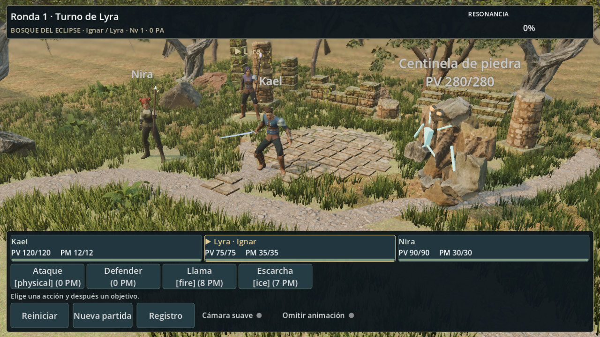
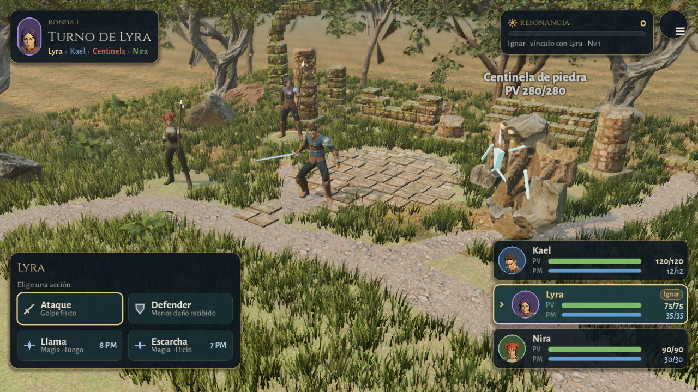
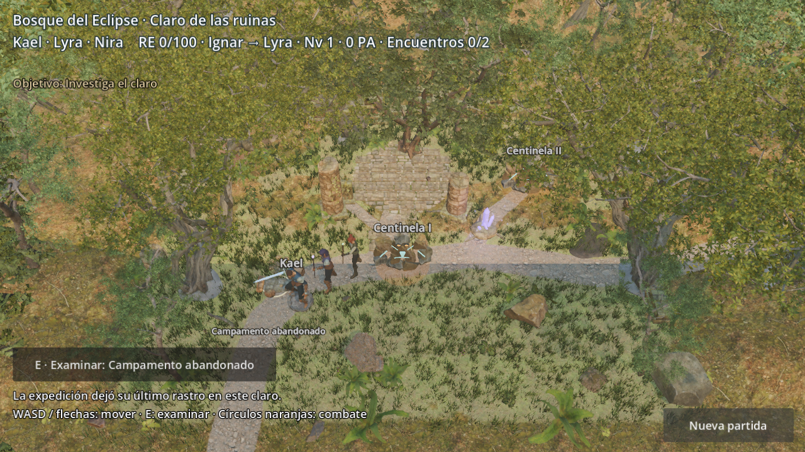
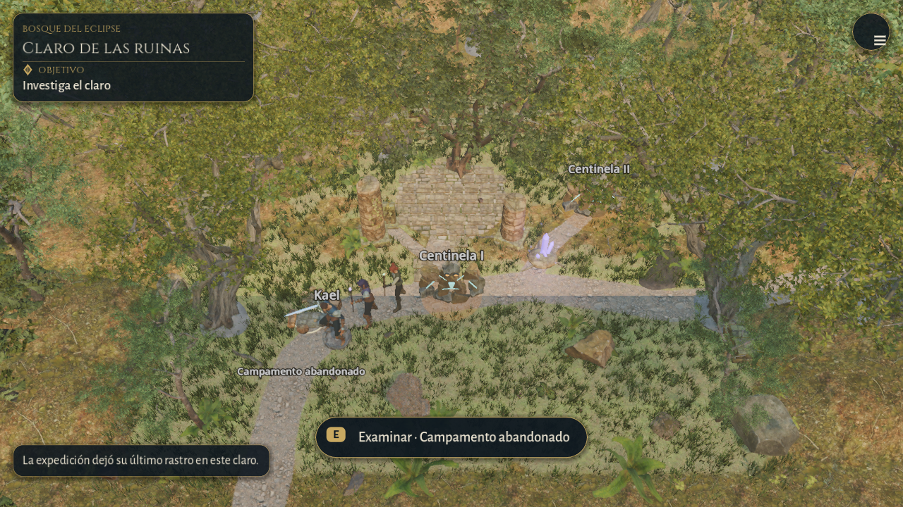
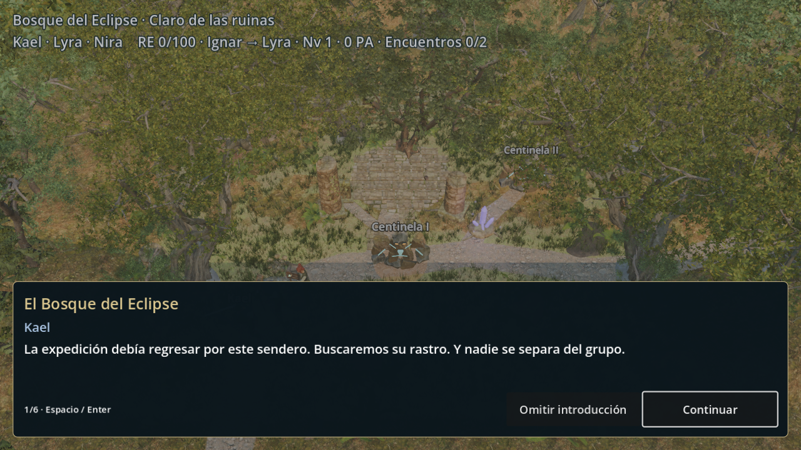
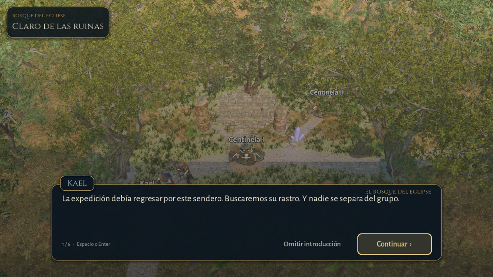

# Interfaz 1.5: combate y exploración

La interfaz deja de parecer una herramienta de depuración. Es una fantasía estilizada y sobria: paneles azul noche con un filo dorado apagado, títulos en **Cinzel** y texto en **Alegreya Sans**, iconos vectoriales propios, retratos de los héroes y colores de estado diferenciados. No cambia ninguna regla: la interfaz lee el estado que ya han resuelto `BattleEngine`, `PartyState`, `GameSession` y `ExpeditionMission`.

| Antes | Después |
|---|---|
|  |  |
|  |  |
|  |  |

## Combate

- **Cabecera del turno** (arriba a la izquierda): retrato de quien actúa, «Turno de Lyra», la ronda y el orden que queda en la ronda, con un color por personaje y el enemigo en rojo. Durante una animación muestra «Acción de Lyra».
- **Resonancia** (arriba a la derecha): valor y barra ámbar, y debajo el Guardián y su vínculo («Ignar · vínculo con Lyra · Nv 1»; los PA aparecen al pasar el puntero). Al llegar a 100 el panel se ilumina con un pulso suave, que solo dura mientras la invocación está disponible, y el texto cambia a «Ignar listo para Lyra».
- **Tarjetas del grupo** (abajo a la derecha): retrato, nombre, barras de PV y PM con sus valores, y fichas de estado: Defensa, Protege, Impulso, DEF ↓, KO e Ignar. Son estados que ya existen en el motor, solo que ahora se ven. La tarjeta activa lleva borde dorado y una flecha. Los PV pasan a ámbar por debajo del 50 % y a rojo por debajo del 25 %.
- **Ventana de órdenes** (abajo a la izquierda): botones en dos columnas, cada uno con icono, nombre, categoría y coste («Llama · Magia · Fuego · 8 PM»). Las categorías (Ataque, Técnica, Magia, Apoyo, Defender, Guardián) solo sirven de presentación y agrupan habilidades que ya existen según su efecto. Una acción sin PM se atenúa e indica «Faltan PM (7/8)». La invocación aparece resaltada como «Invocar a Ignar · 100 RE».
- **Objetivos**: al elegir una habilidad, la ventana muestra solo los objetivos que da `engine.valid_targets()`. Cada uno indica bando y PV («Enemigo · PV 280/280», «Tú», «Aliado»). En el escenario, un aro tenue señala cada objetivo válido y un aro de color, rojo para enemigos y turquesa para aliados, marca el seleccionado. **Atrás** o **Esc** cancela sin gastar turno.
- **Menú ☰**: agrupa registro del combate, Reintentar o Reiniciar, Volver al claro o Nueva partida, Cámara suave y Omitir animaciones. Ya no ocupan espacio de forma permanente. Al terminar el combate, la ventana de órdenes ofrece las acciones de cierre.
- Los nombres flotantes de los héroes se ocultan en combate, porque las tarjetas ya los muestran. El del enemigo se conserva, más compacto y con contorno.

## Exploración y diálogos

- Arriba a la izquierda solo aparecen el lugar y el **objetivo actual**. Los datos del grupo (RE, Ignar, PA, encuentros) y los controles pasan al **menú ☰** (también con Tab), junto a «Nueva partida».
- Los mensajes de la misión aparecen como un aviso breve abajo a la izquierda y se desvanecen a los 7 s.
- La interacción es una píldora centrada con la tecla: «**E** Examinar · Campamento abandonado». Se puede tocar.
- **Diálogo**: ventana centrada de hasta 900 px, placa con el nombre del hablante en su color, el título de la conversación como contexto discreto, texto a 21 px, «Continuar ›» dorado y «Omitir introducción» discreto. Aparece con un fundido de 0,15 s que no bloquea la entrada. No se ha cambiado ningún texto.

## Componentes

| Archivo | Papel |
|---|---|
| `scenes/ui/eclipse_ui.gd` (`EclipseUI`) | Paleta, fuentes, tema común, paneles, botones, barras, emblemas, márgenes seguros y tweens interrumpibles |
| `scenes/ui/ui_icon.gd` (`UIIcon`) | Iconos dibujados con primitivas (espada, rombo, estrella, cruz, escudo, sol, menú, flechas) |
| `scenes/ui/portraits.gd` (`Portraits`) | Retratos renderizados una vez por sesión a partir del modelo activo (HD, actual o procedural). Sin renderizador, como en las pruebas headless, se usa la inicial en un emblema |
| `scenes/battle_hud_3d.gd` | HUD de combate nuevo |
| `scenes/battle.gd` | La decisión de qué órdenes existen sigue aquí, una sola vez. Nuevos ganchos de presentación: `_add_action`, `_add_invoke`, `_add_enemy_step` y `_add_target`. La batalla 2D de respaldo conserva su aspecto |
| `scenes/battle_stage.gd` | Aros de objetivos válidos y color por bando. Nombres de héroes ocultos en combate |
| `world/forest_zone.gd` | HUD de exploración (lugar y objetivo, menú, aviso, píldora de interacción) |
| `narrative/dialogue_box.gd` | Nueva presentación del diálogo, con el mismo comportamiento |
| `tools/capture_ui.gd` | Capturas reales `before`/`after` con los mismos estados y resoluciones |

## Móvil y resoluciones

La base sigue siendo 960×640 con `stretch=canvas_items` y `aspect=expand`, de modo que la altura lógica es 640 y la anchura crece con el formato. Todo se coloca con anclajes y tamaños mínimos a partir de los márgenes seguros que da `DisplayServer.get_display_safe_area()`, con un mínimo de 16 px. Los botones miden al menos 48×48 px lógicos.

He comprobado, con render real y con pruebas:
- **16:9**: 1280×720.
- **19,5:9**: 1560×720.
- **Formato compacto**: 960×540.

En las tres resoluciones, para los estados de órdenes, objetivos y Resonancia llena, todos los controles caben en pantalla, son táctiles y los cuatro paneles no se solapan.

Capturas en [previews/ui/](previews/ui/):
- [combate 19,5:9](previews/ui/after-battle-19x9.png) y [960×540](previews/ui/after-battle-960x540.png);
- [objetivo enemigo](previews/ui/after-target.png) y [aliado](previews/ui/after-target-ally.png);
- [Resonancia al 100 %](previews/ui/after-resonance.png);
- [PV bajos y estados](previews/ui/after-states.png), también en [19,5:9](previews/ui/after-states-19x9.png) y [960×540](previews/ui/after-states-960x540.png);
- [registro](previews/ui/after-log.png);
- [exploración 16:9](previews/ui/after-exploration-16x9.png), [19,5:9](previews/ui/after-exploration-19x9.png) y [960×540](previews/ui/after-exploration-960x540.png);
- [diálogo de pista](previews/ui/after-dialogue-clue.png).

Cada una tiene su equivalente `before-*`.

Para regenerarlas: `godot --path . --script res://tools/capture_ui.gd -- --tag=after`.

## Rendimiento

- No hay desenfoques, shaders de interfaz ni transparencias apiladas: son StyleBox planos con una sombra pequeña.
- La única animación en bucle es el pulso de Resonancia llena, y solo mientras se puede invocar.
- Las barras y las ventanas se animan entre 0,12 y 0,3 s. Con «Omitir animaciones» se actualizan al instante.
- Las tarjetas se construyen una vez y después solo se actualizan.
- Los retratos se renderizan una sola vez por sesión, en subviewports de 160 px que se liberan después.

## Pruebas

`tests/ui_checks.gd` suma 33 comprobaciones:
- orden y categorías de órdenes, sin etiquetas técnicas;
- costes y motivo de las acciones deshabilitadas;
- objetivos válidos, aros por bando y cancelación con Esc sin gastar turno, PM ni RE;
- cambio de turno, y PV y PM leídos del motor;
- PV críticos y fichas de estado;
- Resonancia, invocación e Ignar;
- reinicio, menú de opciones y resultado;
- tres resoluciones en tres estados;
- diálogo (placa, título original, teclado);
- HUD de exploración (menú, objetivo, interacción).

Las suites anteriores siguen sin cambios en sus aserciones. La única adaptación es de implementación: el título del diálogo conserva su texto original y se dibuja en mayúsculas con `Label.uppercase`.

## Límites

- El movimiento en exploración sigue siendo por teclado. La interfaz está preparada para tocar (botones grandes, píldora de interacción y menú), pero no hay joystick virtual: se dejó fuera del alcance para no añadir controles a medio hacer. La API `set_movement_input()` ya existe para cuando se implemente.
- El tamaño físico de los botones depende de la densidad del dispositivo: 48 px lógicos equivalen a unos 40 px a 960×540. Hay que comprobarlo al exportar. No hay exportación móvil ni medición de rendimiento en móvil.
- En el registro de combate siguen apareciendo los textos del motor tal como los genera.
- El enemigo conserva su nombre y PV flotantes. Con varios enemigos podría convenir un panel específico.
